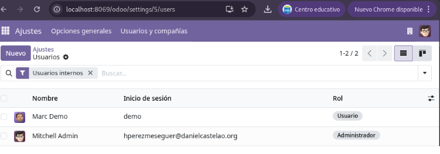
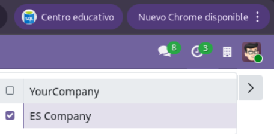
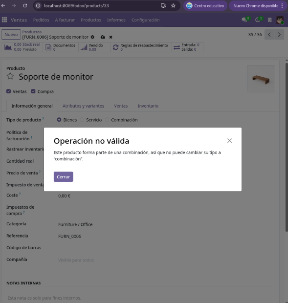

# SXE09

## 1. BASE DE DATOS

### - `demo` BD

Para crear la base de datos de prueba, rellenamos los diferentes campos siguiendo lo puesto en los archivos de configuración anteriores.

Además, como trabajamos desde España, tenemos que configurar el idioma en `Spanish \ Español` y el país en `Spain`.

Por último, marcamos la opción `Demo Data` para que nos de información de prueba para explorar las funcionalidades de Odoo.

### - `real` BD

Para crear la base de datos real de nuestra empresa después de haber explorado las funcionalidades, deberemos entrar en `web/database/manager`. Ahí nos saldrá la base de datos `demo` y, para crear otra, le daremos a `Create database`. 

Rellenaremos la información de la misma manera que antes, pero con otro nombre y sin marcar la opción de `Demo Data` y así tendremos nuestra base de datos real.

## 2. ENTRADA EN ODOO Y DEMOSTRACIÓN

Al entrar, estaremos en el menú de aplicaciones, donde podemos activar diferentes aplicaciones para nuestra empresa.

Si en la aplicación pone `Activar` es una funcionalidad gratuita en cambio, si pone `Actualizar`, es de pago.

A continuación, comprobamos los usuarios y el tipo de impuesto que se pone por defecto al elegir de país España.

Podemos observar que hay 2 usuarios, el administrador y uno de demostración, el tipo de impuesto es del 21% y que se crea una empresa adicional
española.

## 3. TIPOS DE PRODUCTO

Para poder ver los diferentes tipos de productos, tendremos que activar la funcionalidad de `Ventas`.

Una vez activada, nos movemos a su menú y tenemos que ir a la pantalla de productos de la siguiente manera: `Ventas` -> `Productos` -> `Productos`.

### - BIENES CON SEGUIMIENTO

Para poder diferenciar los bienes con seguimiento de los que no lo tienen, tenemos que activar la funcionalidad de `Inventario`.

Al instalarla, nos aparecerá una opción llamada `Rastrear inventario` con una checkbox marcada si se rastrea el inventario o una checkbox sin marcar si no se rastrea.

### - BIENES SIN SEGUIMIENTO

### - SERVICIOS

Los servicios se distinguen porque donde pone `Tipo de producto` sale marcada la opción `Servicio`.

### - COMBINACIÓN

Una combinación de productos se distingue de la siguiente manera: donde pone `Tipo de producto` va a salir marcado `Bienes` y si cambias el tipo a
`Combinación` te va a salir el aviso de la imagen. Si no lo es, te deja cambiar libremente.

