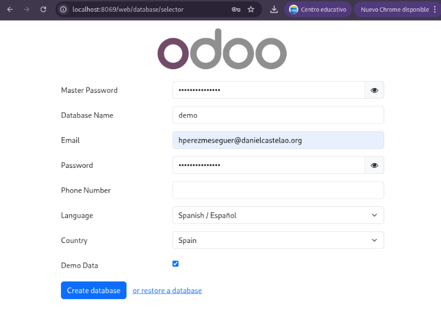

# SXE09

## BASE DE DATOS

### 1. `demo` BD

Para crear la base de datos de prueba, rellenamos los diferentes campos siguiendo lo puesto en los archivos de configuración anteriores.

Además, como trabajamos desde España, tenemos que configurar el idioma en `Spanish \ Español` y el país en `Spain`.

Por último, marcamos la opción `Demo Data` para que nos de información de prueba para explorar las funcionalidades de Odoo.

### 2. `real` BD
