# SXE09

## 1. BASE DE DATOS

### - `demo` BD

Para crear la base de datos de prueba, rellenamos los diferentes campos siguiendo lo puesto en los archivos de configuración anteriores.

Además, como trabajamos desde España, tenemos que configurar el idioma en `Spanish \ Español` y el país en `Spain`.

Por último, marcamos la opción `Demo Data` para que nos de información de prueba para explorar las funcionalidades de Odoo.

### - `real` BD

Para crear la base de datos real de nuestra empresa después de haber explorado las funcionalidades, deberemos entrar en `web/database/manager`. Ahí nos saldrá la base de datos `demo` y, para crear otra, le daremos a `Create database`. 

Rellenaremos la información de la misma manera que antes, pero con otro nombre y sin marcar la opción de `Demo Data` y así tendremos nuestra base de datos real.

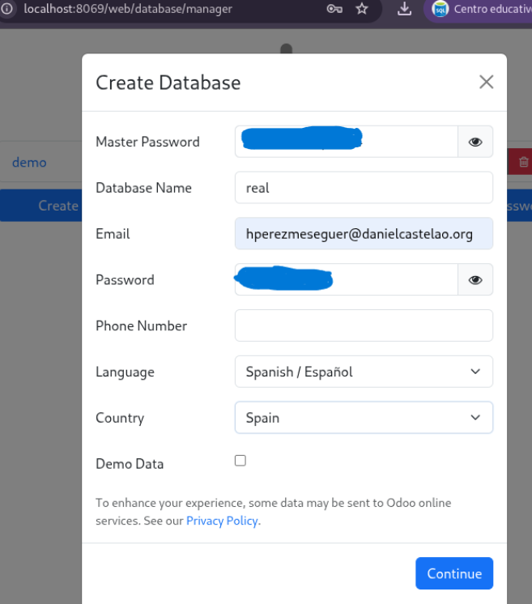
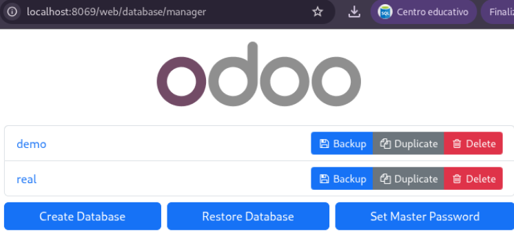

## 2. ENTRADA EN ODOO Y DEMOSTRACIÓN

Al entrar, estaremos en el menú de aplicaciones, donde podemos activar diferentes aplicaciones para nuestra empresa.

Si en la aplicación pone `Activar` es una funcionalidad gratuita en cambio, si pone `Actualizar`, es de pago.

A continuación, comprobamos los usuarios y el tipo de impuesto que se pone por defecto al elegir de país España.

Podemos observar que hay 2 usuarios, el administrador y uno de demostración, el tipo de impuesto es del 21% y que se crea una empresa adicional
española.

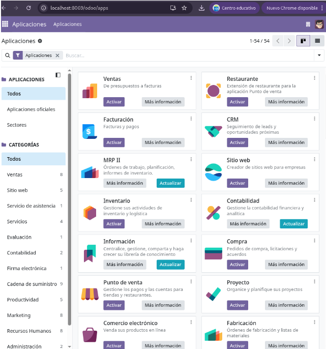

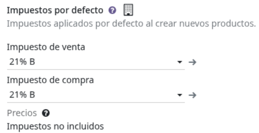

## 3. TIPOS DE PRODUCTO

Para poder ver los diferentes tipos de productos, tendremos que activar la funcionalidad de `Ventas`.

Una vez activada, nos movemos a su menú y tenemos que ir a la pantalla de productos de la siguiente manera: `Ventas` -> `Productos` -> `Productos`.

### - BIENES CON SEGUIMIENTO

Para poder diferenciar los bienes con seguimiento de los que no lo tienen, tenemos que activar la funcionalidad de `Inventario`.

Al instalarla, nos aparecerá una opción llamada `Rastrear inventario` con una checkbox marcada si se rastrea el inventario o una checkbox sin marcar si no se rastrea.

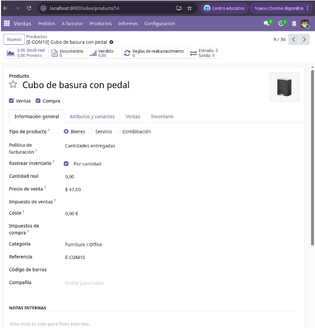

### - BIENES SIN SEGUIMIENTO

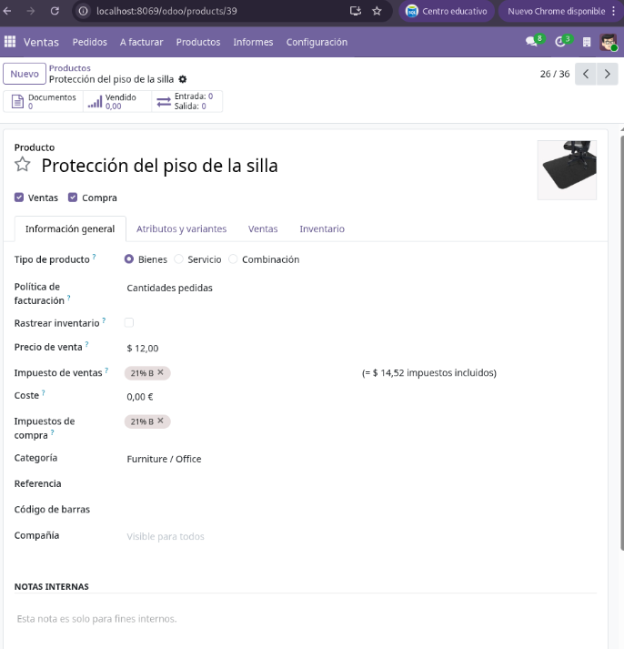

### - SERVICIOS

Los servicios se distinguen porque donde pone `Tipo de producto` sale marcada la opción `Servicio`.

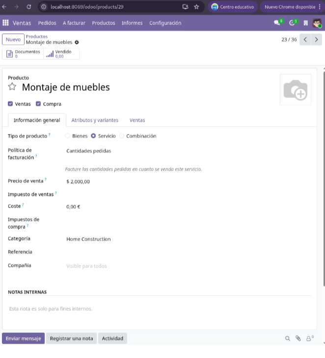

### - COMBINACIÓN

Una combinación de productos se distingue de la siguiente manera: donde pone `Tipo de producto` va a salir marcado `Bienes` y si cambias el tipo a
`Combinación` te va a salir el aviso de la imagen. Si no lo es, te deja cambiar libremente.

## 4. RECORRIDO

En este apartado, tendremos que activar la funcionalidad de `Contactos`.

### - COMPARACIÓN CONTACTO EMPRESA/PERSONA

Podemos observar que en la ficha de la compañía hay información como su dirección, el NIF de la empresa, su sitio web y una serie de etiquetas de 
lo que esa empresa es hacia la nuestra.

En el caso que muestro, podemos ver que tiene las etiquetas `Proveedor` y `Fabricantes de escritorios`.

Además, tenemos información sobre los trabajadores de la empresa dentro la propia ficha.

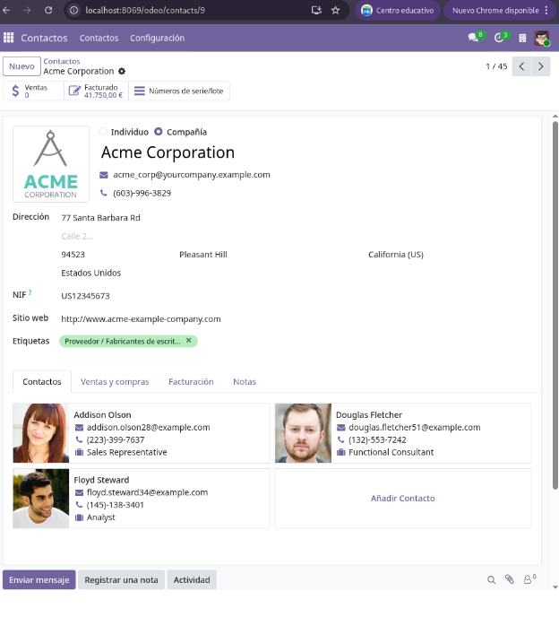

En cambio, en la ficha del trabajador, la información que se muestra diferente a la ficha de la empresa es el DNI de la persona y su puesto de trabajo en la compañía.

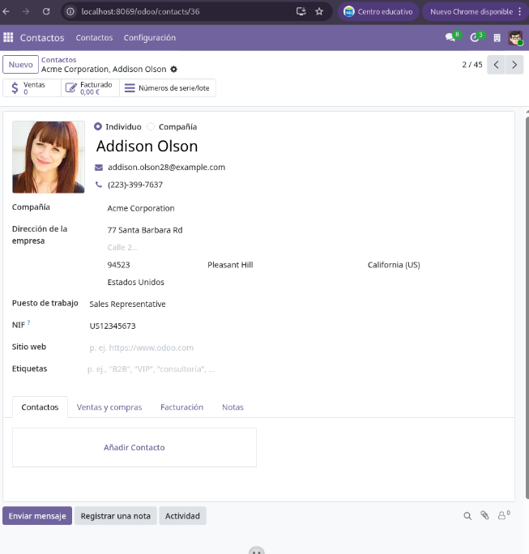

### - CREACIÓN NUEVO CONTACTO EMPRESA

Para crear una nueva ficha de empresa, le damos a `Nuevo` arriba a la izquierda y elegimos si crear un individuo o una compañía.

En la ficha ponemos la siguiente información: el nombre de la compañía, la dirección, el NIF, las etiquetas que sean oportunas y, si queremos, una foto de la compañía.

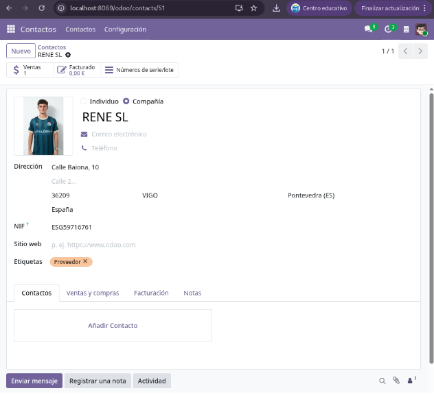

### - CREACIÓN SERVICIO Y BIEN

Volvemos a la funcionalidad de `Ventas` y le volvemos a dar a  `Nuevo` arriba a la izquierda.

Primero creamos un servicio la opción `Servicio` y le ponemos el nombre del servicio que ofrecemos.

A continuación, marcamos que solo se podrá vender marcando la opción `Ventas`, le ponemos el precio de venta que será de 40€ y un IVA del 21% sobre servicios.

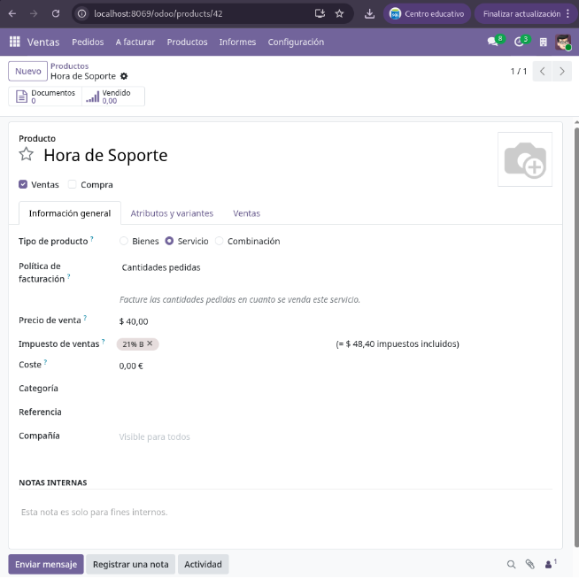

Para crear un producto de tipo `Bienes` seguimos el mismo proceso, pero modificando los datos necesarios.

En este caso, marcamos que sea un bien, le asignamos el precio de 25€ y un 4% de IVA sobre bienes.

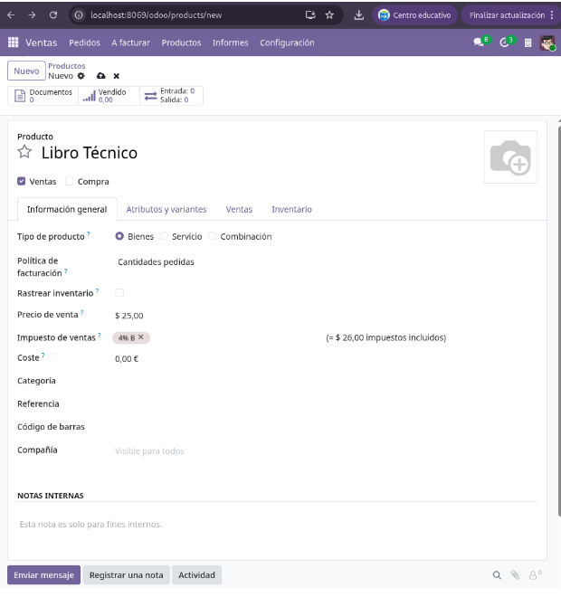

### - CREACIÓN PRESUPUESTO PARA EL CLIENTE CREADO CON LOS PRODUCTOS CREADOS

Para crear un presupuesto, entramos en `Ventas` -> `Pedidos` -> `Presupuestos` -> `Nuevo`.

Elegimos al cliente al que queremos hacer un presupuesto y los bienes y/o servicios que quiere comprar/contratar. 

En este caso, son el cliente y los productos que acabamos de crear, así que añadimos esa información a la hoja.

Antes de darle a `Enviar`, tenemos que ir a la pestaña de `Otra Información` y añadir un almacén. 

Para esto, tenemos que activar la funcionalidad `Almacén` y crear uno para nuestra empresa. Una vez hecho, añadimos el almacén al presupuesto.

Una vez tengamos todo bien, enviamos el presupuesto y si la fase cambia de `Presupuesto` a `Pedido de venta` ya habremos enviado el presupuesto.

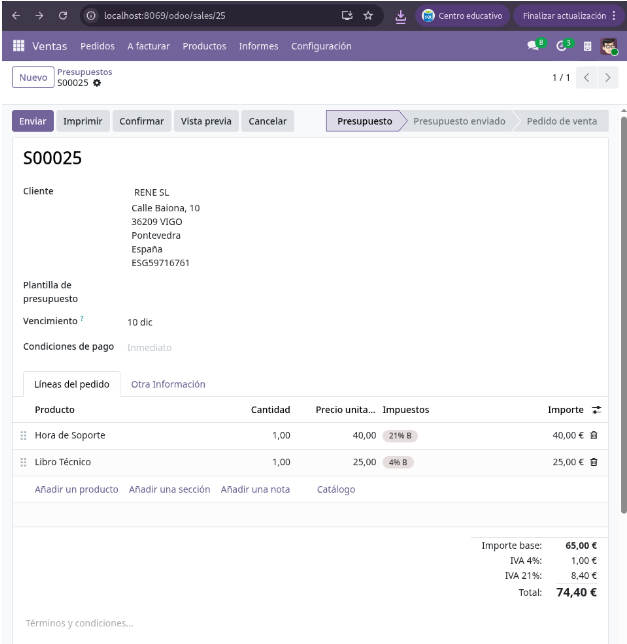
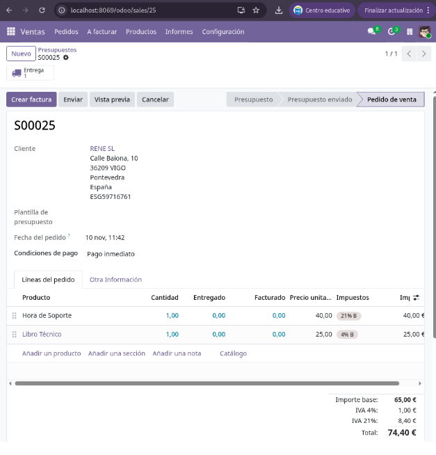

### - CREACIÓN DE LA FACTURA

Le damos a `Crear factura` y nos aparecerá un borrador en el que comprobaremos que todo está correcto.

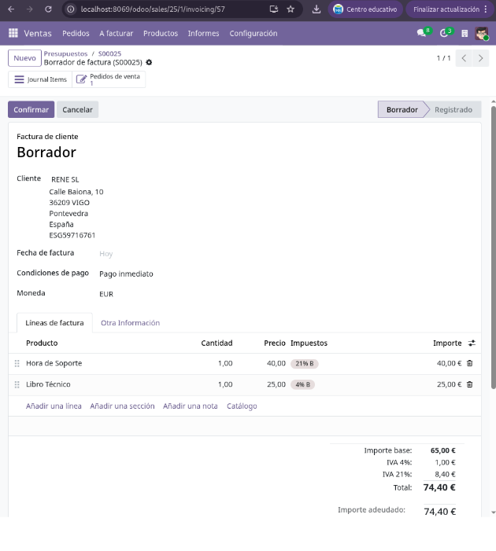

Si todo está bien, la confirmamos e imprimimos la factura. 

Nos dejará elegir el diseño de la factura.

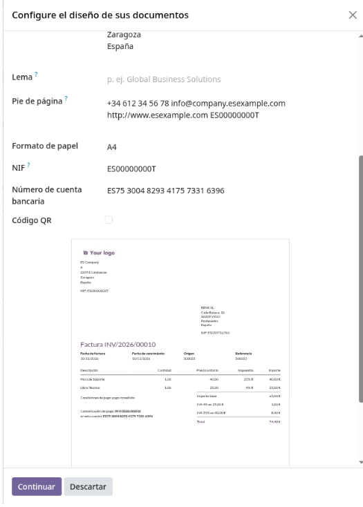
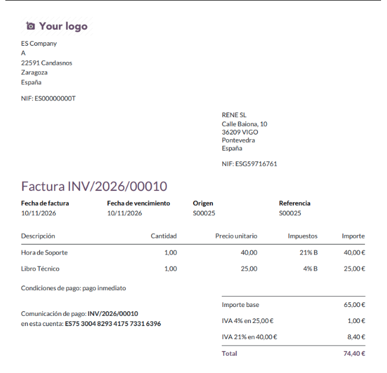

Una vez todo hecho, la enviamos.

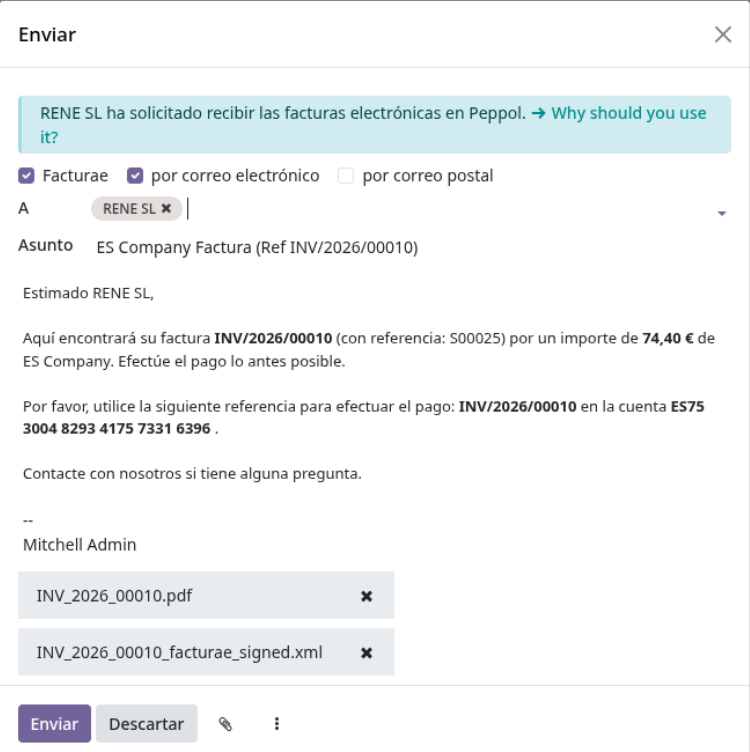

Para registrar el pago nos aparecerá una opción de `Pagar` y le damos a `Crear pago`.

Si se pagó satisfactoriamente, aparecerá una etiqueta de `Pagado` como la de la imagen y enviamos la factura completa.

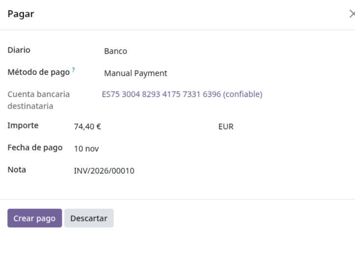
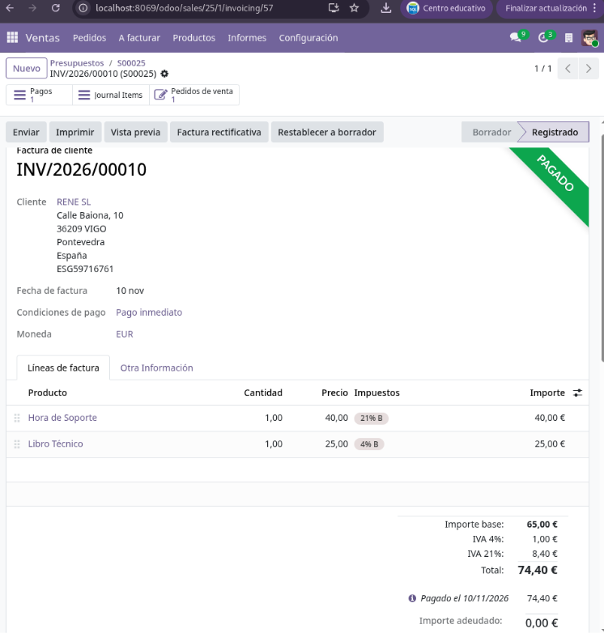

### - CHATTER

Debajo de la factura, nos aparecerá un área llamada `Actividades planificadas`. 

Creamos una nueva que sea una llamada y la guardamos.

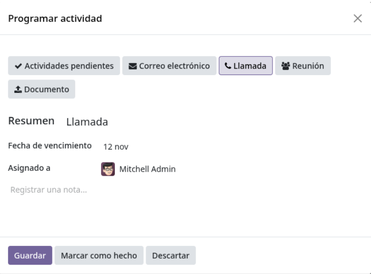
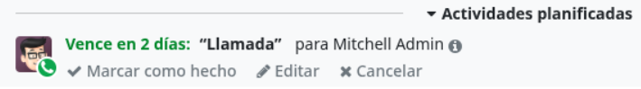

